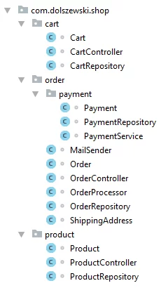
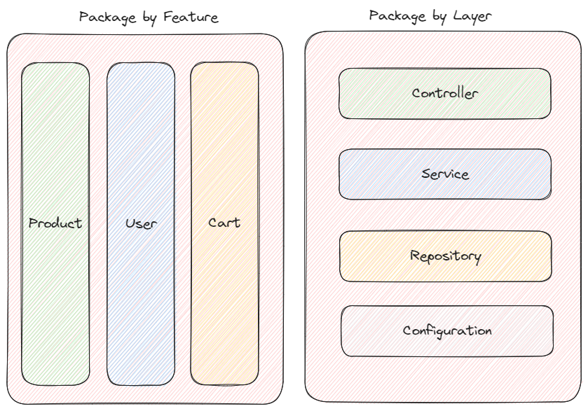

08/09

- Criação do projeto do zero, minha primeira dúvida não foi tão usual, preciso criar o projeto em um repositório da minha conta pessoal, como vou utilizar o mac tenho que conciliar minha conta do github do trabalho vinculada ao intelij com a minha pessoal. Não me importo em commitar com esse úsuario, o importante é manter o repositório no meu github pessoal.
- Como fazer isso? Posso vincular meu SSH pessoal ao inteliJ

__

- Penso que a primeira coisa a fazer ao criar o projeto é estruturar a arquitetura de pasta e para esse projeto usaremos package by feature, add abaixo um exemplo de referência: 

- Para iniciar a criação da arquitetura pesquisei como é a arquitetura java normalmente (por que sei que tem varias pastas dentro de pastas)
- Como primeira tarefa organizei as pastas da feature tutor.

__

Segundo passo:
- add as dependências do projeto, quero entender como usar site spring initializr.
- 